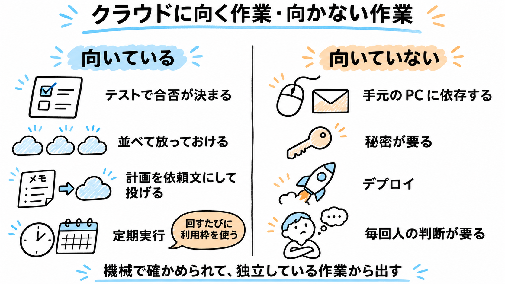
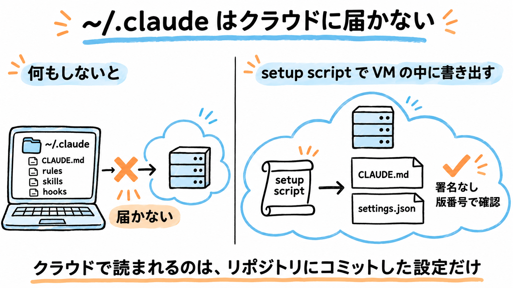
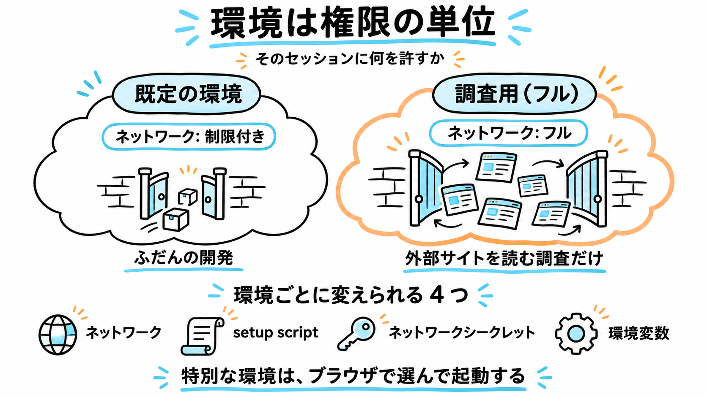
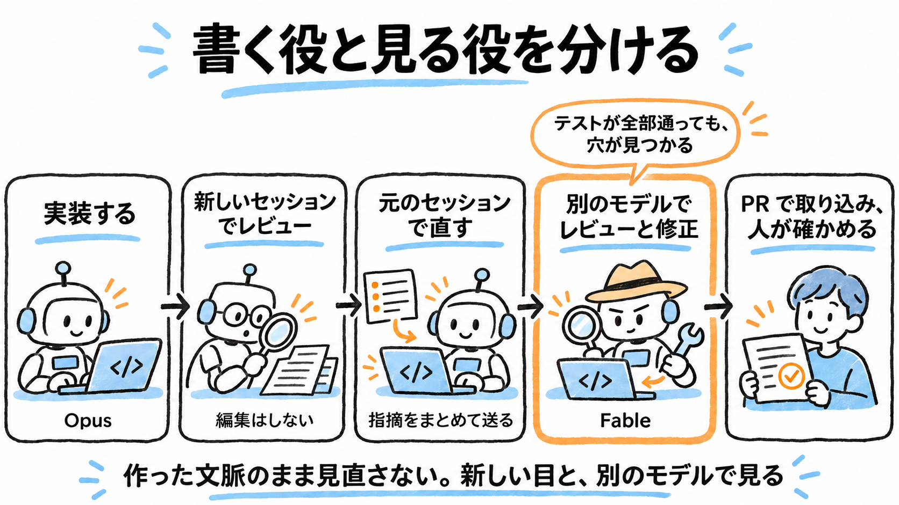
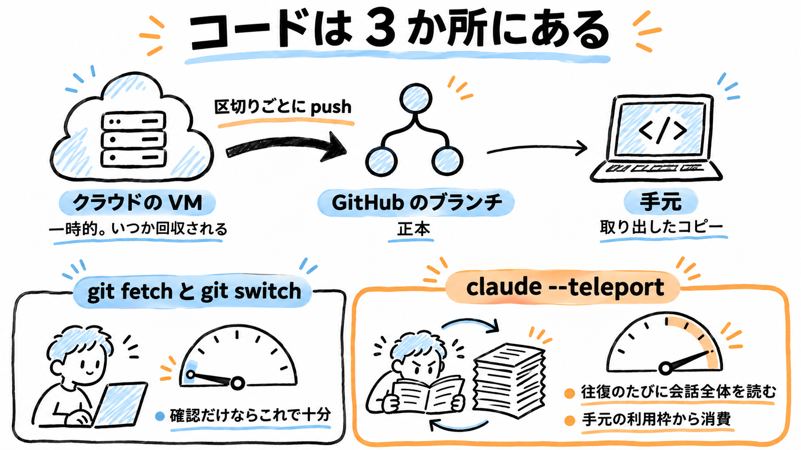

Claude Code のクラウドセッションは、Anthropic の VM で Claude Code を動かし、結果をブランチで受け取る仕組みです。ローカルの Claude Code に慣れている人が、最初に知っておくと迷わない設定と使い方をまとめました。

- **手元の `~/.claude` はクラウドに届きません。** 自分のルールを効かせるには、環境の setup script で VM の中に書き出します
- **環境は「権限の単位」です。** 普段はネットワークを絞った環境、外部サイトを読む作業だけ「フル」の環境、と分けます
- **`claude --teleport` は手元の利用枠を大きく使います。** 会話全体を往復のたびに読み直すので、成果の確認は `git fetch` と `git switch` で済ませます

:::message
**対象読者**: コーディングエージェント（Claude Code など）は使い慣れていて、クラウドセッションはこれからの人
**時点**: 2026-11 時点の内容です。画面と仕様は変わることがあります
:::

## クラウドセッションとは

Anthropic が用意する VM の中で Claude Code を動かす仕組みです。セッションは GitHub のリポジトリを clone して作業し、結果をブランチに push します。手元の PC を閉じても作業は進み、何本も並べて走らせられます。

手で起動する入口は 4 つあります。

- ブラウザの claude.ai/code
- Claude アプリの Code タブ
- デスクトップアプリの Cloud
- ターミナルの `claude --cloud "タスク"`（旧名 `--remote`）

VM は Ubuntu 24.04 で、おおむね 4 vCPU・メモリ 16GB・ディスク 30GB です。Node.js、Python、Docker、PostgreSQL、Chrome for Testing、gh が入っています。

## 向いている作業・向かない作業

設定に入る前に、何をクラウドに出すかを決めておきます。



| 向いている | 向いていない |
|---|---|
| テストや lint で、合否を機械で判定できる作業 | 手元の PC に依存する作業（GUI、メール、手元のファイル） |
| 独立していて、並べて放っておける小さめの作業 | 秘密（API キーなど）が要る作業 |
| 手元で計画を固め、依頼文にしてから投げられる作業 | デプロイ |
| 決まった手順を定期的に回す作業（定期実行・Routines） | 毎回人の判断が要る作業 |

:::message alert
定期実行は、実行のたびに利用枠を使います。2026 年秋に配られたクラウドセッションのボーナスクレジットも、Routines は対象外でした[^credit]。頻度と 1 回あたりの重さを見積もってから仕込みます。
:::

判断事項は推奨付きの表で返させて人が選ぶ、という形にすると、並列で回しても人の作業が詰まりません。

## 最初にやる設定

### ~/.claude は届かない

クラウドセッションが読む設定は、リポジトリにコミットしたものだけです。手元の `~/.claude/` に書いたルール（署名を付けない、秘密を扱わない、範囲外を実装しない など）は、クラウドでは効きません。手元の git フックも動きません。

| 置き場所 | クラウドで |
|---|---|
| リポジトリにコミットした `CLAUDE.md`・`.claude/` | 読まれる |
| 手元の `~/.claude/` の `CLAUDE.md`・rules・skills・hooks・ユーザー設定 | 読まれない |



何もしなければ届かず、setup script で VM の中に書き出して初めて効きます。

### setup script で VM に書き出す

setup script は、新しいセッションの開始時、Claude Code の起動前に VM で実行されるシェルスクリプトです。環境ごとに 1 つ設定でき、結果はキャッシュされます。公式ドキュメントにも `~/.claude/CLAUDE.md` を書き出す例があります。環境の設定は、環境セレクターの「クラウド ›」から開きます。

```bash:setup script（要点）
#!/bin/bash
mkdir -p "$HOME/.claude"

# 手元の CLAUDE.md から、クラウドで意味のあるルールだけを書き出す
cat > "$HOME/.claude/CLAUDE.md" <<'EOF'
# クラウドセッション共通ルール
確認用の版: CLOUD-RULES-2026-11-04
- コミット・PR に AI の署名を付けない
- main に直接 push しない。作業ブランチを切って push する
- push の前に `gh api repos/{owner}/{repo} --jq .visibility` で公開範囲を確かめる。public なら止まる
- 秘密を扱わない。指示の範囲外を実装しない。検証してから完了と言う
EOF

# コミットと PR の署名、Claude-Session トレーラーを消す（既存の settings.json があればマージ）
ATTRIBUTION_JSON='{"attribution":{"commit":"","pr":"","sessionUrl":false}}'
SETTINGS_PATH="$HOME/.claude/settings.json"
if [ -s "$SETTINGS_PATH" ] && jq empty "$SETTINGS_PATH" 2>/dev/null; then
  merged_path="$(mktemp)"
  jq -s '.[0] * .[1]' "$SETTINGS_PATH" <(echo "$ATTRIBUTION_JSON") > "$merged_path" && mv "$merged_path" "$SETTINGS_PATH"
else
  echo "$ATTRIBUTION_JSON" | jq . > "$SETTINGS_PATH"
fi
exit 0
```

- **版番号を入れておく**と、セッションに聞くだけで読み込まれたかを確かめられます。`/context` の Memory files に `/root/.claude/CLAUDE.md` が出るかでも確かめられます
- `attribution.sessionUrl` は既定で `true` で、クラウドのコミットに `Claude-Session` トレーラーが付きます。settings.json を書き出すのは公式の例には無い工夫です
- トレーラーを消しても、コミットの作者欄は `Claude` になります
- setup script は環境を使う人なら誰でも読めます。秘密は書きません

### ネットワークは既定のまま

既定は「制限付き」＋「パッケージマネージャーを許可」です。「フル」にすると、プロンプトインジェクションを受けたときに外へ持ち出す経路になります。広い権限が要る作業は、後で書く別の環境に分けます。

## 起動と追加の指示

ターミナルからの起動は数秒で戻り、待たされません。手元に push していないコミットはクラウドに入らないので、先に push しておきます。

```bash
claude --cloud "依頼文"
claude --cloud "$(cat prompt.md)"   # 長い依頼はファイルから
```

実行中・完了後のセッションには、ブラウザを開かずに追加の指示を送れます。指示は待ち行列に入り、セッションが今の作業に区切りをつけてから反映されます。

```bash
claude -p "追加の指示" --cloud <session-id>
claude -p --cloud <session-id> < followup.md   # 長い指示は標準入力から
```

:::message
筆者の環境では、新しいセッションの起動は対話型のターミナルからしかできませんでした（エージェントのツールから実行すると `Error: --cloud requires an interactive terminal.`）。追加の指示はツールからでも送れたので、「起動は人、追加の指示はエージェント」という分担が回しやすいです。
:::

- **組織のリポジトリ**は、組織側にも Claude GitHub App を入れます。無いと手元のリポジトリを丸ごとアップロードする方式になります
- **新しく作る小物**は、先に GitHub に空のリポジトリを作っておくと、結果を push で受け取れます
- **依頼には「区切りごとにコミットして push」を入れます**（理由は注意点を参照）

## 環境を使い分ける

環境ごとに変えられるのは、ネットワーク・setup script・ネットワークシークレット（鍵を Claude に見せず、通信にだけ付ける）・環境変数の 4 つです。環境を「そのセッションに何を許すか」の単位と考えると、使い分けが決めやすくなります。



普段の開発は既定の環境、外部サイトを読む調査だけ「フル」の環境で動かします。

- setup script は環境ごとに独立しています。新しい環境にも同じものを貼り、版を上げたらすべての環境に貼り直します
- CLI の `/remote-env` で選んだ環境は、以後の `claude --cloud` の既定になります。特別な環境はブラウザで選んで起動し、送ったら既定に戻しておくと安全です

## レビューをクラウドで回す

書く役とレビューする役を分けるのは、ローカルでも同じ一般原則です。クラウドで違うのは、その分け方が楽になる点です。

- 文脈を持たない新しいセッションを、手元の作業を止めずに並べて立てられます
- ブラウザから起動するときにモデルを選べるので、書いたのとは別のモデルにレビューさせやすくなります
- 指摘は `claude -p --cloud` で元のセッションへ送れ、ブラウザを開かずに直させられます



- 指摘は重さで分けさせると扱いやすくなります（例: このままでは出せない／直す／記録して通す）
- 修正は、レビューした側か元のセッションに、指摘をまとめて `claude -p --cloud <id> < fix.md` で送ります。レビュー画面に出る「〜を直して」の返信候補は押しません
- モデルを途中で切り替えると、直後の 1 回目は会話全体をキャッシュなしで読み直します[^cache]。レビュー用のモデルは新しいセッションで選ぶほうが無駄がありません
- 取り込みは PR にし、最後は普段の開発環境でテストを通します。クラウドと手元で結果が分かれることがあります

## 成果の受け取り方

コードはクラウドの VM・GitHub のブランチ・手元の 3 か所にあり、正本は GitHub のブランチです。確認やテストだけなら、ブランチを取ってくれば足ります。



| やりたいこと | 方法 | 手元の利用枠 |
|---|---|---|
| 差分を見る | `git fetch` と `git diff`、またはブラウザの差分表示 | ほぼ使わない |
| 手元でテストする | `git fetch` → `git switch <クラウドのブランチ>` | ほぼ使わない |
| 経緯を覚えたまま、手元でしかできない作業をさせる | `claude --teleport <session-id>` | 大きく使う |

:::message alert
`claude --teleport` は、開いた時点でクラウドの会話全体を読み込み、往復のたびに読み直します。筆者の実測では、約 100k トークンの会話を開いただけで入力 102.7k、1 回質問すると累計 197.4k になりました。この消費はクラウドのクレジットではなく、手元の通常の利用枠から出ます。
:::

`git pull` は今いるブランチしか更新しません。`git switch` はリモートのブランチから手元のブランチを自動で作ります。

## 注意点

### VM はいつか回収される

VM は操作がないまま数分で停止し、そのうち回収されます。回収までの時間は公式に書かれていません。回収されると push していない変更と実行中の処理は消え、会話の履歴だけが残ります。時間を当てにせず、依頼の時点で「区切りごとにコミットして push」を指示しておきます。

### 止まったセッションに CLI の指示が届かないことがある

止まっていたセッションに `claude -p --cloud` で送った指示が、長時間処理されないことがありました。ブラウザのセッション画面の入力欄から送り直すと動きます。

### 公開リポジトリの成果は受け取りが面倒

push の前に公開範囲を確かめて止まるルールにしていると、公開リポジトリでは成果をパッチで受け取ることになり、手間がかかります。最初から非公開のリポジトリで作業させるか、公開してよい内容に限ると割り切るほうが楽です。

### セッションをまたぐと情報が欠ける

レビュー結果を別のセッションに中継させると、要約の段階で取り違えが起きます。指摘は原文のまま渡します。AGENTS.md などの記述と実際の設定（デプロイの方式など）が違うこともあるので、大事な前提は実物で確かめます。

## 参照

- [Use Claude Code in the cloud](https://code.claude.com/docs/en/claude-code-on-the-web)
- [Configure cloud environments](https://code.claude.com/docs/en/cloud-environments)
- [Settings reference（attribution）](https://code.claude.com/docs/en/settings-reference)
- [Prompt caching（Switching models）](https://code.claude.com/docs/en/prompt-caching#switching-models)

[^credit]: Claude ヘルプ「Cloud sessions bonus credit promotion」の「What doesn't the credit cover?」。https://support.claude.com/en/articles/17152539-cloud-sessions-bonus-credit-promotion
[^cache]: Prompt caching の「Switching models」。https://code.claude.com/docs/en/prompt-caching#switching-models
